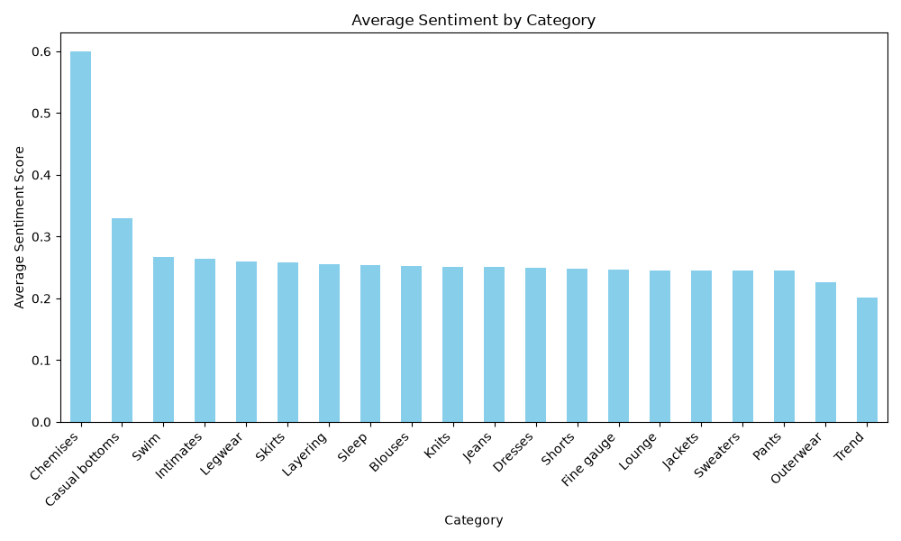

# Myntra Fashion Analytics

Python + KNIME project analyzing fashion product reviews (sentiment) and product images (color analysis).

## Python Analysis

### Sentiment Analysis
- Used TextBlob for polarity scoring
- Classified reviews as Positive / Neutral / Negative
- Category-wise average sentiment

### Key Findings
- Trend category has the lowest sentiment
- Negative reviews frequently mention: size, fabric, thin, quality
- Most categories have 80%+ positive reviews

### Image Analysis
- Downloaded 47 fashion product images
- Extracted dominant colors
- Most common colors: Blue, White, Yellow, Gray

## Screenshots

## Files
- `python/nlp_analysis.py` — Sentiment analysis + visualization
- `python/image_analysis.py` — Image color analysis
- `python/combined_insights.py` — Combined summary
- `knime/myntra_sentiment.knwf` — KNIME workflow
- `data/` — Datasets and results
